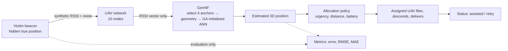

# 3D Genetic Neural Fusion for Multi-UAV Localization and Flood Emergency Response
**Multi-UAV Localization and Flood Emergency Response**
*An interactive Python simulation for RSSI-based 3D localization, cooperative UAV coordination, and first-aid delivery in flood-affected environments.*

> Tagline: *RSSI-based 3D victim localization with Genetic Neural Fusion, driving a 10-UAV flood-rescue simulation.*
> Suggested topics: `uav` `multi-agent-systems` `rssi` `localization` `genetic algorithm` `artificial neural network` `disaster-response` `plotly` `streamlit` `simulation`

⚠️ **Simulation only.** RSSI is synthetic and missions are simulated. Nothing here establishes field performance or is a real emergency system.

## 1. Relationship to the paper
Based on the author's paper **"RSSI Guided Localization Using Genetic Neural Fusion in Multi-UAV Network"**, IEEE Access, 2025
([IEEE Xplore](https://ieeexplore.ieee.org/document/11037754/)) and its MATLAB script (`gen + ANN.txt`).


| Layer | Module | Status |
|---|---|---|
| Legacy data flow of the MATLAB script (to demonstrate the leak) | `legacy_original.py` |
| **GenNF, corrected & leak-free** (my reconstruction; needs verification against the paper) | `localization.py`, `genetic_optimizer.py`, `neural_model.py`, `rssi_model.py` | core research module |
| **New extensions**: flood environment, UAV motion, allocation policy, dashboard | everything else | not part of the published method |

## 2. Features
* 10-UAV network by default (adjustable 4-20), log-distance RSSI model with noise, range limits and degenerate-case guards.
* GenNF localization: RSSI → ranges → strongest-4 anchor selection (correct UAV IDs) → geometric stage → GA-initialised ANN refinement.
* Procedural 3D flood settlement (water, severity zones, buildings, roads/submerged roads, bridge, trees, base station, hazard cylinders).
* Animated UAV patrols/missions with flight paths, RSSI links, truth-vs-estimate error lines, delivery points; play/pause/scrub in the browser.
* Greedy first-aid allocation (urgency → nearest feasible idle UAV), mission timing, retry on missed drops.
* Dashboard metrics computed from live simulation state; CSV export; research-experiment mode with baselines and ablations.

## 3. Architecture & workflow

`src/gennf/`: `rssi model` · `localization` · `genetic optimizer` · `ANN model` · `legacy_original` · `uav network` · `flood environment` · `rescue allocation` · `simulation` · `experiments` · `metrics` · `visualization`. UI: `app.py`.

## 4. Mathematics
RSSI(d) = P₀ − 10·n·log₁₀(d/d₀) + 𝒩(0, σ²) dBm, inverted as d̂ = d₀·10^((P₀−RSSI)/(10n)). Distances use x, y **and** z.
RMSE = √mean(‖êₛₜ − true‖²) is the **3D Euclidean** position RMSE; MAE is per-axis; mean error and success rate are reported separately.

## 5. Install (Windows)
```
python -m venv .venv
.venv\Scripts\activate
python -m pip install -r requirements.txt
```
(macOS/Linux: `source .venv/bin/activate`.) Python 3.11 or 3.12.

## 6. Run
```
python -m streamlit run app.py          # dashboard
python -m pytest                        # tests (43)
python scripts/run_experiment.py --seeds 0 1 2 3 4 --trials 200 --noise-sweep --ablation --out results
python scripts/export_results.py --seed 42 --out results   # CSVs + standalone scene.html
```
**Playback:** the whole mission is simulated once, then played as Plotly frames in the browser (rotate/zoom/play/pause/scrub with the
3D figure's own controls). The sidebar's *Run / Reset* re-simulates with new settings (seed, node count, noise, …); a step slider inspects
metrics/charts at any time step. Limitation: changing a parameter requires a re-run rather than live mid-flight editing.
CSV export: download buttons in the dashboard or `scripts/`.

## 7. Reproducibility
All randomness is seeded (`seed` in `SimConfig`/`ExperimentConfig`); tests assert identical outcomes for identical seeds.


## 8. Roadmap
Verify GenNF against the paper's equations and add a "published results" comparison · shadowing/NLOS/multipath models · RSSI-guided
UAV motion (active localization) · multi-target tracking · learned/auction task allocation · fair comparison with the paper's CNN-RNN/LSTM/GRU, particle and Kalman baselines.

## 9. Citation
See [`(https://ieeexplore.ieee.org/document/11037754/)`](https://ieeexplore.ieee.org/document/11037754/).
